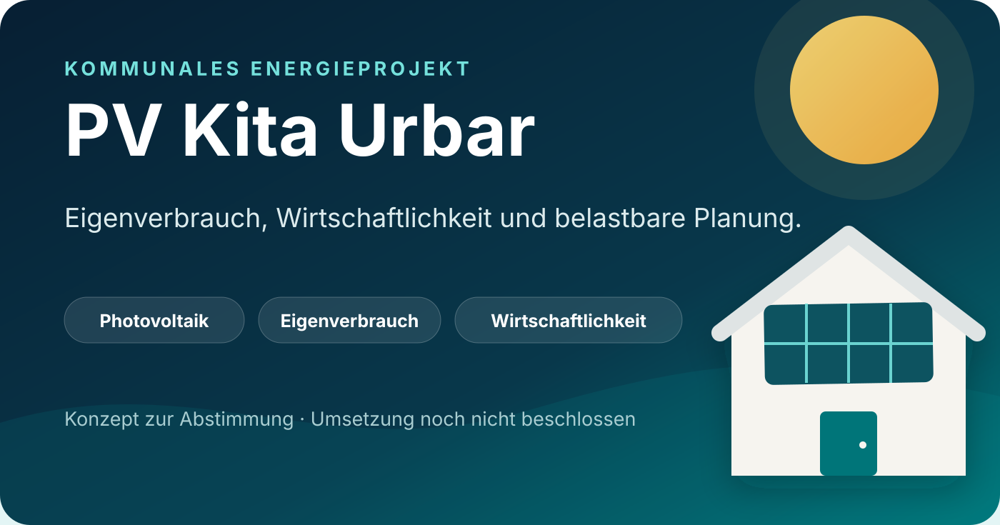
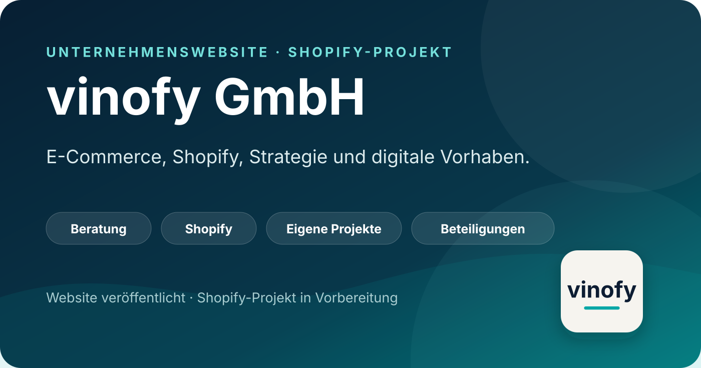
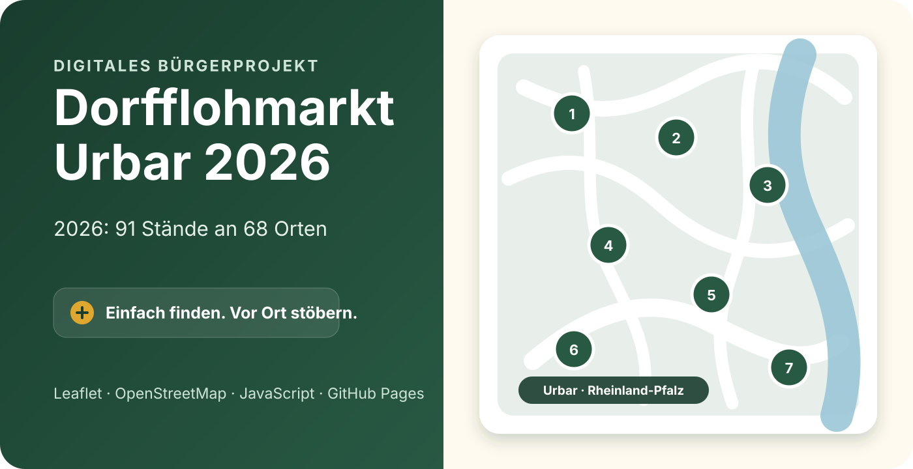
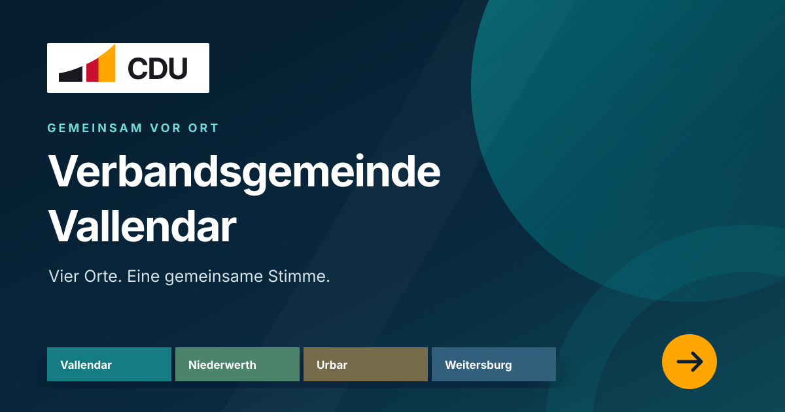
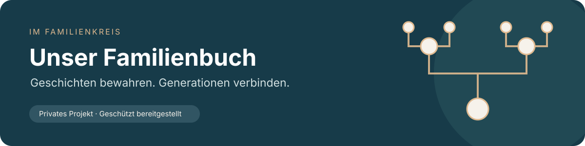

 

<strong>Unternehmer · Kommunalpolitiker · digitale Projekte, Energie und eigene Beiträge</strong>

  

## Profil

Ich bin Geschäftsführer der [**vinofy GmbH**](https://vinofy.de/) und kommunalpolitisch in **Urbar** sowie in der **Verbandsgemeinde Vallendar** aktiv.

GitHub nutze ich als öffentliche Werkbank für Websites, Bürger- und Energieprojekte sowie nachvollziehbare digitale Arbeitsabläufe. Entscheidend ist nicht die technische Spielerei, sondern ob eine Lösung verständlich ist, ein konkretes Problem löst und dauerhaft gepflegt werden kann.

Meine persönliche Website [**marcopusceddu.de**](https://marcopusceddu.de/) ist die zentrale Plattform für mein berufliches Profil, mein kommunalpolitisches Engagement, konkrete Projekte sowie eigene Berichte und Positionen.

### Arbeitsweise

- konkret statt abstrakt
- verständlich statt unnötig kompliziert
- nachvollziehbar dokumentiert
- mobil und barrierearm gedacht
- wirtschaftlich und praktisch geprüft
- für den tatsächlichen Einsatz gebaut

## Aktuell im Fokus

### PV Kita Urbar

 

Konzept für eine Photovoltaikanlage auf dem Dach der Kita „Unter dem Regenbogen“ in Urbar. Ziel ist, den erzeugten Strom möglichst direkt in der Kita zu nutzen und ihre laufenden Stromkosten zu senken.

**Arbeitsstand:** Ein Konzept zur Beteiligung des Fördervereins und eine interne Arbeitsgrundlage sind ausgearbeitet. Vorgesehen ist, Spenden und Unterstützung örtlicher Fachbetriebe zu gewinnen. Die Ortsgemeinde soll die Anlage anschließend übernehmen und betreiben.

**Status:** Konzept zur Abstimmung. Finanzierung, Zuständigkeiten sowie rechtliche und steuerliche Voraussetzungen sind noch zu klären. Die Umsetzung ist noch nicht beschlossen.

---

### vinofy GmbH & Shopify

 

Unternehmenswebsite der vinofy GmbH mit den Schwerpunkten E-Commerce, Shopify-Beratung und dem praktischen Einsatz von KI. Sie stellt Leistungen, unternehmerische Erfahrung und eigene digitale Projekte vor.

**Shopify-Projekt:** Ein eigener Shop ist als begleitendes Praxisprojekt in Vorbereitung. Er soll praktische Erfahrungen für die Entwicklung und Begleitung von E-Commerce-Projekten liefern.

**Status:** Unternehmenswebsite veröffentlicht. Shopify-Projekt in Vorbereitung; ein öffentlicher Verkaufsstart ist noch nicht erfolgt.

---

### E-Mail-Signaturen für Apple Mail

Einheitliche E-Mail-Signaturen für drei unterschiedliche Kommunikationsbereiche: **vinofy**, **CDU** und **privat**. Die Varianten sind für **Apple Mail auf dem Mac** fertiggestellt und zusätzlich auf dem **iPhone** eingerichtet.

**Ziel:** ein konsistenter Absenderauftritt über beide Geräte hinweg – mit klarer Trennung zwischen geschäftlicher, kommunalpolitischer und privater Kommunikation.

**Status:** Die drei Signaturen sind fertiggestellt und auf Mac und iPhone im praktischen Einsatz.

---

### marcopusceddu.de

 

Persönliche Website als zentrale öffentliche Plattform: Unternehmerprofil, kommunalpolitisches Engagement, direkte Kontaktmöglichkeiten sowie ein vollständiger Bereich für Berichte, Einblicke und persönliche Positionen.

**Auf der Website:** Mein berufliches und kommunalpolitisches Profil, eigene Beiträge und Positionen sowie die kommunalpolitischen Themen- und Fraktionsseiten.

**Redaktioneller Ablauf:** Die Website bleibt statisch und schnell. Ein Python-Skript erzeugt aus den freigegebenen Artikeln automatisch Startseitenvorschau, Archiv und Sitemap. Prüfungen verhindern fehlerhafte Metadaten, falsche Adressen und zukünftige Veröffentlichungsdaten.

## Weitere Projekte

### Dorfflohmarkt Urbar

 

Mobile Flohmarktkarte für Urbar mit Leaflet und OpenStreetMap. Die Ausgabe 2026 umfasste zuletzt 91 Verkaufsstände an 68 Orten. Nach der Veranstaltung wurde die Website auf einen Ausblick für 2027 umgestellt.

**Weiterentwicklung:** Für die nächste Ausgabe ist eine Online-Anmeldung mit Sortimentsauswahl, optionalem Standnamen und Foto vorgesehen. Kartenpunkte sollen automatisch vorbereitet und vor der Veröffentlichung geprüft werden. Damit soll die bisherige manuelle Pflege in Excel abgelöst werden.

**Arbeitsstand:** Eine Fotofunktion mit geschützter Übertragung, Prüfung und Freigabe wurde auf Cloudflare-Basis erfolgreich getestet. Der Entwicklungsstand ist gesichert; die vollständige Standanmeldung und Verwaltung für 2027 sind noch nicht umgesetzt.

---

### Vereinsring Urbar

 

Öffentliche Website-Vorschau für den Vereinsring und die Urbarer Vereine. Sie bündelt Vereinsinformationen, Termine und gemeinsame Aktionen. Formulare bereiten Veranstaltungsmeldungen und Materialanfragen als E-Mail vor.

**Arbeitsstand:** Die Vorschau ist für Smartphone, Tablet und Desktop ausgearbeitet. Für den offiziellen Betrieb sind noch die Domain- und E-Mail-Anbindung sowie die Bestätigung der Inhalte, Kontaktdaten und Ausleihbedingungen erforderlich.

**Status:** Öffentliche Vorschau zur Abstimmung. Der offizielle Start ist noch nicht bestätigt.

---

### CDU Verbandsgemeinde Vallendar

 

Gemeinsamer Website-Auftritt für die CDU in Vallendar, Niederwerth, Urbar und Weitersburg. Die öffentliche Vorschau bündelt Vorstand, örtliche Ansprechpartner, Fraktionsinformationen, kommunalpolitische Themen und Anträge.

Eine Räteübersicht unterscheidet den Verbandsgemeinderat, den Stadtrat Vallendar und die Ortsgemeinderäte Niederwerth, Urbar und Weitersburg. Ergänzend ist ein geschütztes Funktionsträgerportal mit internen Arbeitsmitteln und Gestaltungsleitfaden eingerichtet.

**Status:** Öffentliche Vorschau und internes Portal sind eingerichtet. Der vollständige offizielle Website-Start ist noch nicht bestätigt; die abschließende Freigabe und die Umstellung der Kontakt- und Mailadressen stehen noch aus.

---

### Unser Familienbuch

 

Privates digitales Familienbuch mit Lebensgeschichten, Fotos, Personensuche und einem Stammbaum über mehrere Generationen. Es verbindet Familiengeschichte mit einer übersichtlichen, digital durchsuchbaren Darstellung.

**Zugang und Datenschutz:** Das Familienbuch ist ausschließlich für freigegebene Familienmitglieder zugänglich. Eine Anmeldung per E-Mail-Code schützt den Zugang; sensible Familieninhalte und Bilder werden zusätzlich verschlüsselt und mit dem Familienpasswort im Browser geöffnet.

**Status:** Geschützt bereitgestellt. Anmeldung, Zugriffsschutz und die Anzeige entschlüsselter Inhalte wurden getestet. Quellcode und Familieninhalte bleiben privat.

## Themen und Arbeitsfelder

**Unternehmen und digitale Vorhaben**  
E-Commerce · Shopify · Shopify-Account und Shop · KI im Arbeitsalltag · Unternehmenswebsites · digitale Geschäftsmodelle · Beteiligungen

**Energie und kommunale Projekte**  
Photovoltaik · Eigenverbrauch · Wirtschaftlichkeitsvergleich · Investitionsrahmen · Entscheidungsgrundlagen

**Kommune und Bürger**  
Digitale Bürgerinformation · kommunale Infrastruktur · Energie und Glasfaser · transparente Kommunikation

**Vereine und Ehrenamt**  
St. Sebastianus Schützengesellschaft Urbar · Gemeinsame Öffentlichkeitsarbeit · Veranstaltungskalender · digitale Zusammenarbeit · Sichtbarkeit des Vereinslebens

**Publikation und digitale Kommunikation**  
Statische Websites · Beitragsarchive · automatisierte Übersichten · Metadatenprüfung · Suchmaschinen-Vorbereitung · HTML-Signaturen · Apple Mail

**Technik und Zuhause**  
Loxone · UniFi · Smart-Home-Integration · Energie- und Netzwerktechnik

## Werkzeugkasten

> **„Technik ist dann gut, wenn sie ein konkretes Problem löst und ohne dickes Handbuch funktioniert.“**

